<p align="center">
  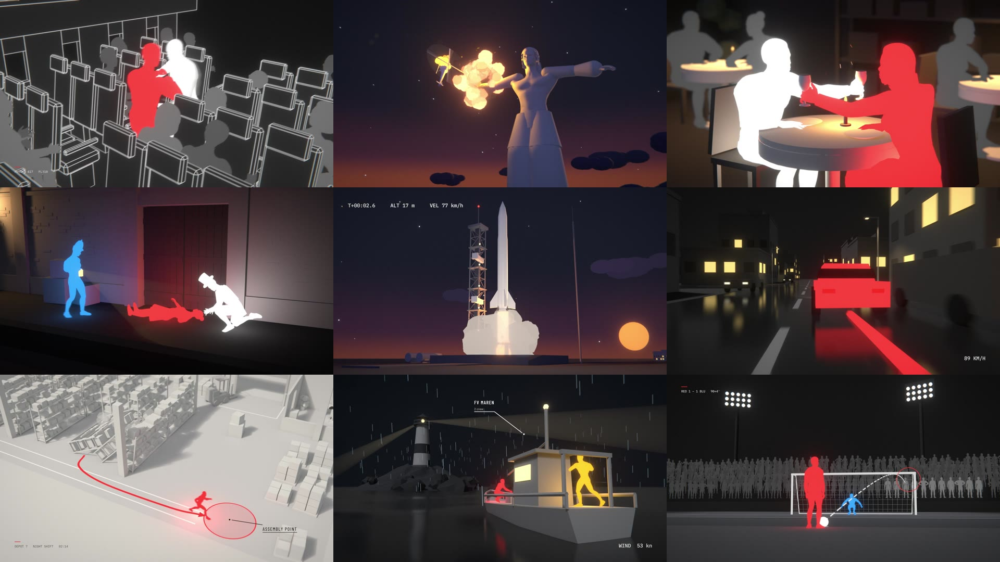
</p>

# umbra

**2.5D silhouette-and-diorama animation, written in Python, built for AI agents.**
Describe a scene in ~60 lines; umbra stages it in Blender, lights it, animates it and renders a
1080p film on your GPU. No Blender skills, no keyframing, no node graphs.

```python
from umbra import *

class Hello(Scene):
    duration = 8

    def build(s):
        s.table(at=(0, 0)); s.chair(at=(0, -0.75)); s.lamp(at=(0, 0), kind="pendant")
        a = s.person(at=(0, -0.75), color=WHITE).sit(pose="sit_table")
        b = s.person(at=(3.5, 2.5), color=RED, build="woman", hair="long")
        b.walk((0.9, 0.5), t=1, dur=3).pose("wave", t=4.2)
        a.look_at(b.anchor("head"), t=2.5)
        s.cam.set(pos=(4.5, -5.5, 3.2), look=(0.3, 0, 1), lens=45)
        s.cam.orbit(25, t=0, dur=8)
        s.label(b.anchor("above"), "Hello", t=4.4, out=7.4)
```

```bash
python -m umbra render scenes/00_hello.py      # -> out/00_hello.mp4
```

<p align="center">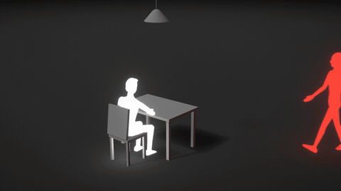</p>

## Gallery

Ten 20-second films, each one a single Python file in [`scenes/`](scenes). The first drafts of scenes 04–10
were written by fresh AI agents from [`AGENTS.md`](AGENTS.md), in at most six contact-sheet iterations each;
their friction reports shaped the API you see here.

<table>
<tr>
<td width="50%"><a href="scenes/01_cabin_fight.py">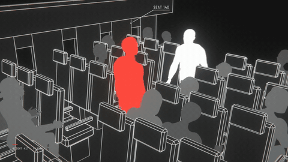</a><br><sub><b>01 · Cabin fight</b> — <code>blueprint</code> look, crowd, fight choreography, a dive through cloud</sub></td>
<td width="50%"><a href="scenes/02_corcovado.py">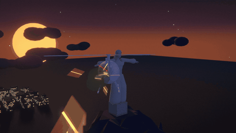</a><br><sub><b>02 · Corcovado</b> — <code>dusk</code> look, terrain, chase cam, explosions, falling wreck</sub></td>
</tr>
<tr>
<td><a href="scenes/03_dinner_date.py">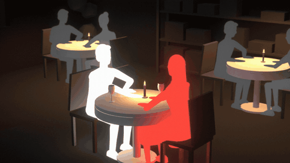</a><br><sub><b>03 · Dinner date</b> — candle light, hand IK, shallow focus</sub></td>
<td><a href="scenes/04_crime_scene.py">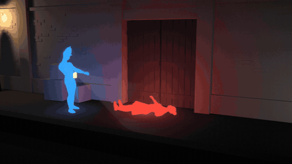</a><br><sub><b>04 · Crime scene</b> — <code>noir</code> look, lantern beam, callout labels</sub></td>
</tr>
<tr>
<td><a href="scenes/05_rocket_launch.py">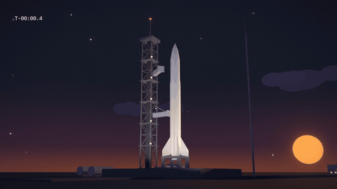</a><br><sub><b>05 · Rocket launch</b> — countdown, fire and smoke riding a moving anchor</sub></td>
<td><a href="scenes/06_night_chase.py">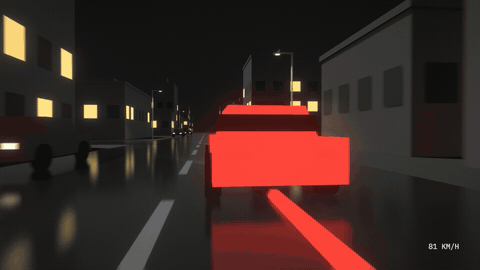</a><br><sub><b>06 · Night chase</b> — procedural city, headlights, route trails</sub></td>
</tr>
<tr>
<td><a href="scenes/07_warehouse.py">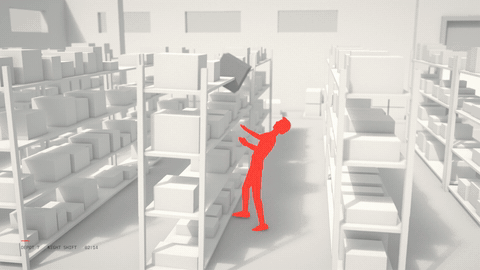</a><br><sub><b>07 · Warehouse</b> — <code>clay</code> look, tilt-shift miniature</sub></td>
<td><a href="scenes/08_storm.py">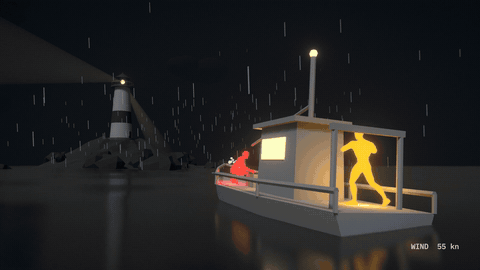</a><br><sub><b>08 · Storm</b> — water, rain, lightning, a sweeping beam</sub></td>
</tr>
<tr>
<td><a href="scenes/09_penalty.py">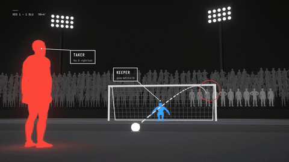</a><br><sub><b>09 · Penalty</b> — crowd, ball trajectory, broadcast-style graphics</sub></td>
<td><a href="scenes/10_orbit.py">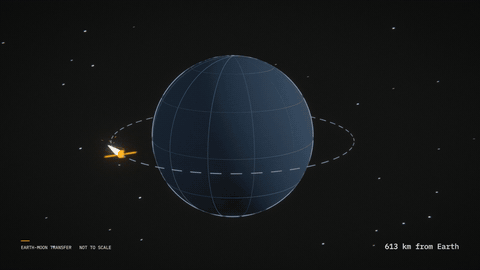</a><br><sub><b>10 · Orbit</b> — no people: pure motion graphics in space</sub></td>
</tr>
</table>

## Install

| need | version | notes |
|---|---|---|
| [Blender](https://www.blender.org/download/) | 4.5 LTS or newer (developed on 5.2) | found automatically, or set `UMBRA_BLENDER=/path/to/blender` |
| ffmpeg | any recent | on `PATH` (or `pip install imageio-ffmpeg`) |
| Python | 3.9+ | only runs the CLI; no packages to install |
| GPU | anything Blender's EEVEE runs on | NVIDIA / AMD / Intel / Apple; no CUDA or OptiX setup |

```bash
git clone https://github.com/MusicMaster4/umbra-25d && cd umbra-25d
python -m umbra doctor                      # checks Blender + ffmpeg
python -m umbra sheet scenes/00_hello.py    # a contact sheet in ~10 s
```

## For AI agents

Point your agent at the repo and say what film you want. [`AGENTS.md`](AGENTS.md) (also loaded through
`CLAUDE.md`) is a single page with the whole API, the working loop and the art-direction rules; an agent
does not need to read the source.

> Read AGENTS.md, then write `scenes/lighthouse.py`: a 20-second film of a fishing boat in a storm
> near a lighthouse. Iterate with `python -m umbra sheet` until it looks right, then render it.

The loop is built to be cheap in tokens:

| step | command | cost |
|---|---|---|
| see the whole film | `python -m umbra sheet scene.py` | one image (12 timestamped frames), ~10 s |
| check a moment | `python -m umbra sheet scene.py -t 4.2 -t 4.6 -t 5.0` | one image |
| check detail | `python -m umbra still scene.py -t 6.5` | one 1080p frame |
| check without rendering | `python -m umbra lint scene.py` | text only, no GPU, ~5 s |
| deliver | `python -m umbra render scene.py` | mp4; the ten films here took 3–20 min each (median 7) at 1080p on an RTX 3070 |

<p align="center">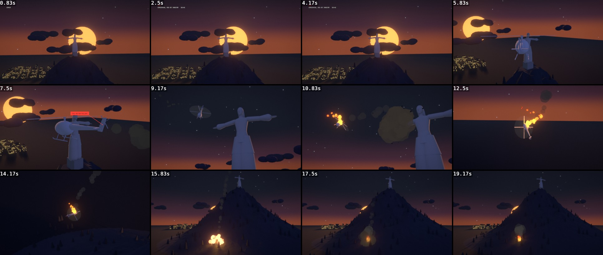<br>
<sub>What an agent looks at: one contact sheet of the whole timeline.</sub></p>

## What you get

**Looks** — one word sets the background, light rig, materials, lens and grade. Override any field with
`NOIR.but(...)`. The default stage is `#151515`.

<p align="center">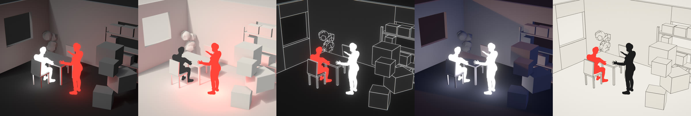</p>

**People** — real human silhouettes. The figures are skinned bodies (a male and a female base mesh from Blender
Studio's CC0 *Human Base Meshes*, dressed in thin shirt / trouser / shoe shells) on a 15-bone rig fitted to the
mesh's own joints, with anatomical limits: elbows and knees are hinges that only fold one way. 59 library poses,
two-bone hand and foot IK, head tracking, gestures, hats, hair, outfits, five builds.

<p align="center">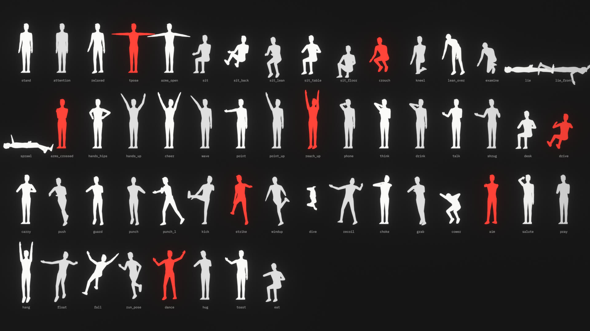</p>

**Motion templates** — nothing is hand-keyed. `p.walk(to, style=...)` drives each foot along a path (pinned to the
ground through stance, heel peeling off, arcing forward in swing) and solves the legs by IK, so feet never slide
or sink and the stride always matches the speed. Eleven styles: `stroll walk march carry sneak limp trudge drunk
jog run sprint`; walks route around furniture on their own. `p.act(...)` plays whole moves as one smooth curve
through key poses, eased in and out: `jump pick_up throw punch kick wave clap cheer bow look_around check_watch
stumble dance climb sit_down stand_up` and more.

<p align="center">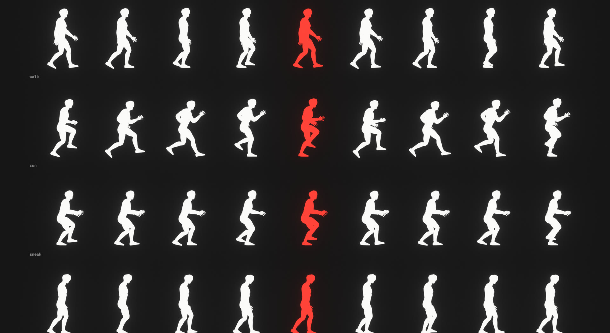</p>

`python -m umbra lint tests/motion.py` audits every gait and action at 60 Hz for pops, ease-in / ease-out, joint
limits and floor contact (currently 38 / 38 clean).

**A kit** — furniture, rooms with cut-away walls, buildings and whole cities, cars, an airliner and its
cabin, helicopter, boats, rocket, train, trees, terrain, water, clouds — plus a small mesh builder
(`box`, `cyl`, `lathe`, `extrude`, `loft`, `tube`…) for everything else.

**Camera** — `set`, `to`, `cut`, `orbit`, `push`, `track`, `follow`, `shake`, `handheld`; depth of field,
motion blur, bloom, vignette and film grain are on by default.

**Words** — type that behaves: callout labels that follow a 3D point, corner stamps, captions,
counters and clocks, with entrance presets (`rise`, `type`, `letters`, `wipe`…). Four bundled open-source
typefaces. The defaults are deliberately small and sparse.

**FX** — fire, smoke, explosions, debris, sparks, dust, rain, snow, lightning, splashes; trails, arrows,
rings, zones and light beams. Particles are analytic, so any frame can be rendered on its own.

**Safeguards** — the usual 3D mistakes are handled before you can make them:

| problem | what umbra does |
|---|---|
| inverted normals, degenerate faces | every mesh is cleaned and re-wound outward on build |
| z-fighting | floor sits 4 mm below z=0; coplanar surfaces are stacked in creation order; kit decals stand proud |
| depth shimmer on far detail | camera clip planes are fitted to the scene every frame (smoothed) |
| smears across teleports and cuts | instant jumps and forgotten cuts are keyed as hard steps |
| flicker | light and glow shimmer is band-limited below 4 Hz, low-passed again at bake time, and every render ends with a measured flicker check |
| clipping | props are solid unless created with `solid=False`; walks route around furniture; hands rest *on* table tops; `lint` flags who passes through what, when, where and from which line of the scene, and circles the spot in magenta on the contact sheet — the agent then fixes it or declares it intended |
| sliding or sinking feet | gaits pin the stance foot by IK; in any pose a sole that would pass through the floor is held on it; a walk asked to go too fast becomes a run |
| joints bending the wrong way | elbows and knees are clamped to 0–150°, spine and neck to human ranges |
| hands turned the wrong way | wrists are clamped to a wrist's range (±90° forearm twist, 75° bend); a palm on a surface faces down on both sides, measured on each body; the audit checks it |
| stiff, splayed hands | fingers have their own joints: relaxed by default, fists for punches and runs, closed around held props, flat on a table |
| hair that floats or bulges | hair is a shell grown from the head's own scalp, so it follows the skull whatever the build |
| motion pops | actions are C1 curves through their key poses; the motion audit measures it |
| labels off-screen, camera under the floor | labels are clamped; the preflight warns |

[`tests/safeguards.py`](tests/safeguards.py) stages all of these on purpose.

## How it works

```
scene.py ──► umbra (Python, inside Blender) ──► EEVEE on the GPU ──► PNG frames ──► ffmpeg ──► mp4
   │              │
   │              ├─ every value is a Track: set / to / fn + additive layers (shake, flicker, gait…)
   │              ├─ tracks are sampled per frame and baked to f-curves; particles and IK are closed-form
   │              └─ a second transparent "overlay" scene carries all 2D text and is composited on top
   └─ declarative: absolute times, any order, everything chainable
```

- Rendering is real-time rasterisation (EEVEE), not path tracing: about 1 s per 1080p frame with soft shadows,
  screen-space GI, depth of field and motion blur. `render -j N` runs N Blender processes side by side.
- `python -m umbra blend scene.py` exports an ordinary `.blend` if you want to keep working by hand.
- Outlines in the `blueprint` look are real geometry pushed out in the vertex shader, so they stay a
  constant width in pixels at any distance or zoom.

## CLI

```
python -m umbra sheet  scene.py [-n 12] [-t T ...] [--range T0 T1] [--cols 4] [--scale 0.25]
python -m umbra still  scene.py -t T [-t T ...] [-q draft|preview|final|ultra]
python -m umbra render scene.py [-q final] [-j 2] [--range T0 T1] [--resume] [--nvenc]
python -m umbra lint   scene.py        # build + every check, no rendering, no GPU
python -m umbra blend  scene.py
python -m umbra api    [word]          # method signatures + docstrings, e.g. `api trail` (also in docs/API.md)
python -m umbra check  video.mp4       # flicker meter
python -m umbra doctor
```

## Layout

```
umbra/        the framework (scene, camera, people, kit, fx, overlay, looks, materials, CLI)
scenes/       example films — start from 00_hello.py
tests/        a deliberately sloppy scene that exercises the safeguards
AGENTS.md     the one-page guide for agents (and humans)
docs/API.md   every public method with its signature (generated by `python -m umbra api`)
```

## Licence

MIT. Bundled fonts (Barlow, Barlow Condensed, IBM Plex Mono, DM Serif Display) are under the SIL Open Font
License; see `umbra/fonts`.
The bodies in `umbra/assets` are derived from Blender Studio's
[Human Base Meshes](https://www.blender.org/download/demo-files/#assets) bundle (CC0); `tools/build_body_assets.py`
rebuilds them from the original file.
